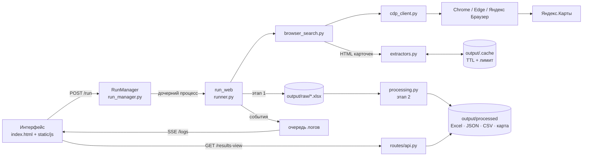

# Архитектура

Приложение — локальный веб-сервер на Flask, который управляет настоящим
Chromium-браузером по Chrome DevTools Protocol. Это не библиотека-парсер и не
SaaS: всё работает на машине пользователя, данные лежат в файлах рядом с
программой, наружу не уходит ничего, кроме запросов к Яндекс.Картам.

Такой выбор объясняет почти все остальные решения: один пользователь, нет БД
и авторизации, зато есть процесс-оркестратор, SSE «на живую» и файлы как
источник правды.

## Компоненты

| Слой | Где | За что отвечает |
|---|---|---|
| Точка входа | [app.py](app.py) | фабрика Flask, выбор порта (`YP_PORT` → dev 5010 → macOS 5050 → 5000), уборка логов/кэша/старых выгрузок при старте |
| HTTP-интерфейс | [routes/parser.py](routes/parser.py), [routes/api.py](routes/api.py) | запуск/стоп/пауза, `/logs` (SSE), таблица результатов, статистика, история, шаблоны, отметки |
| Публичный API | [routes/public_api.py](routes/public_api.py) | `/api/v1/*`: поиск, пачка заданий, статус, результаты, OpenAPI |
| Оркестратор | [run_manager.py](run_manager.py) | реестр прогонов, дочерний процесс, очередь логов, watchdog, пауза/стоп, webhook |
| Прогон | [yandex_maps_parser/runner.py](yandex_maps_parser/runner.py) | цикл по городам и запросам, этап 1 → `raw/`, этап 2 → `processed/` |
| Поиск | [yandex_maps_parser/browser_search.py](yandex_maps_parser/browser_search.py) | выдача Яндекс.Карт: встроенное состояние страницы, запасной разбор вёрстки |
| Браузер | [yandex_maps_parser/cdp_client.py](yandex_maps_parser/cdp_client.py) | поиск установленного Chromium, запуск с CDP, пул вкладок, навигация и чтение HTML |
| Разбор | [yandex_maps_parser/extractors.py](yandex_maps_parser/extractors.py) | карточка организации: контакты, рейтинг, соцсети, сайт |
| Фильтры | [yandex_maps_parser/processing.py](yandex_maps_parser/processing.py) | чёрный список, соцсети, филиалы, «только новые», оценка лида, VK |
| Выгрузки | [yandex_maps_parser/exporters.py](yandex_maps_parser/exporters.py) | Excel, JSON, CSV, HTML-карта |
| Состояние | [yandex_maps_parser/state.py](yandex_maps_parser/state.py), [checkpoint.py](yandex_maps_parser/checkpoint.py), [cache.py](yandex_maps_parser/cache.py) | общие настройки прогона, чекпоинт и «уже видели», кэш страниц |
| Интерфейс | [templates/index.html](templates/index.html), [static/js](static/js), [static/css/style.css](static/css/style.css) | один HTML и модули на чистом JS, без сборщика; темы, таблица, графики, карта |

## Как идёт один прогон

1. `POST /run` валидирует параметры и создаёт запись в `RunManager`. Если уже
   идёт другой прогон, новый встаёт в очередь с позицией — второй браузерный
   цикл поверх первого не запускается.
2. `RunManager.start_process` поднимает отдельный процесс (или поток, если
   процесс недоступен) и мостиком перекладывает сообщения в `queue.Queue`.
   `watchdog` добивает зависший прогон, чтобы интерфейс не ждал вечно.
3. `run_web` на каждый город и запрос открывает выдачу, забирает карточки
   организаций и складывает их в `raw/<запрос>_<город>.xlsx`. Промежуточные
   события уходят в очередь: город, запись, прогресс, предупреждение.
4. После успешного цикла запускается этап 2: `processing.process_all` читает
   все `raw`-файлы прогона, применяет фильтры, считает оценку лида и пишет
   `processed/` в выбранных форматах.
5. `done` закрывает SSE-поток; таблица либо уже наполнялась событиями, либо
   подтягивает срез через `/results-view`.

## Ключевые решения и компромиссы

### 1. Настоящий браузер по CDP вместо Playwright и Selenium

**Решение.** Страницы открывает установленный Chrome (Edge, Яндекс Браузер,
Chromium), приложение общается с ним по CDP через `ws://`.

**Почему.** Пользователь получает ту же сессию, cookies и отпечаток, что и при
обычном просмотре, не нужно тащить в сборку второй браузер на 150–300 МБ, а
поведение ближе к человеку. Плюс можно показать окно и посмотреть, что
происходит.

**Чем платим.** Только Chromium: Safari и Firefox не умеют CDP. Нужен
установленный браузер (понятная ошибка в «Диагностике», если его нет) и
поддержка собственного клиента: пул вкладок, таймауты, переподключение,
закрытие мёртвых вкладок.

### 2. Сначала данные страницы, потом вёрстка

**Решение.** `browser_search` сначала читает встроенное состояние выдачи
(один запрос вместо прокрутки), а если его нет — разбирает DOM.

**Почему.** 4–8 секунд на город вместо десятков секунд ручной прокрутки, и
меньше зависимости от классов в разметке.

**Чем платим.** Внутренний формат страницы не обещан и может измениться;
поэтому запасной путь не удалён, а поддерживается, и оба варианта покрыты
тестами.

### 3. Двухэтапный конвейер `raw → processed`

**Решение.** Этап 1 сохраняет всё, что прошло предфильтр по одной записи
(чёрный список, «только без сайтов», соцсети). Этап 2 применяет фильтры,
которым нужен весь набор: объединение филиалов, «тип компании», оценка лида.

**Почему.** «Применить фильтры заново» пересчитывает выгрузку без повторного
сбора. Сырые данные не теряются, а ошибка в фильтре не требует нового прогона.

**Чем платим.** Два набора файлов и явное правило: расширить срез можно только
новым сбором — об этом предупреждает интерфейс. Если прогон прерван, этап 2
не запускается: лучше отдать сырые данные, чем половину отфильтрованных.

### 4. Прогон в дочернем процессе и очередь логов

**Решение.** `RunManager` держит реестр прогонов, запускает `run_web` отдельным
процессом и читает его сообщения из очереди. Есть запасной режим потока.

**Почему.** Тяжёлый цикл с браузером не блокирует Flask и интерфейс; стоп и
пауза обрабатываются предсказуемо; падение парсера не роняет сервер.

**Чем платим.** IPC: нужно мостить сообщения, следить за `_done`, чистить
реестр (`_sweep`) и не терять финальный `done`, иначе SSE-поток висит.

### 5. Пауза — это graceful stop с чекпоинтом

**Решение.** Пауза выставляет тот же `stop_event`, что и остановка: прогон
аккуратно доводит текущий шаг, сохраняет чекпоинт и финализирует Excel.
«Продолжить» стартует новый прогон с `resume`, который читает чекпоинт.

**Почему.** Нет полузаписанных файлов и «зависших» вкладок; после паузы
данные уже пригодны, даже если продолжение не случится.

**Чем платим.** Пауза не мгновенная: она ждёт завершения текущего города.
Отсюда отдельная кнопка «пропустить город», когда ждать долго.

### 6. Кэш страниц: TTL, лимит и атомарная запись

**Решение.** HTML карточки кладётся в `output/.cache/` на 24 часа; размер
ограничен, старые файлы вытесняются; запись идёт во временный файл и
`os.replace`. Слишком короткие страницы (заглушки, обрыв) не кэшируются.

**Почему.** Повторный прогон по тем же городам не дёргает браузер на каждой
организации и не тратит лимит запросов. Атомарная запись не даёт прочитать
половину файла из другого потока.

**Чем платим.** Данные могут отставать на сутки (`YP_PAGE_CACHE_TTL`), кэш
занимает место (`YP_PAGE_CACHE_MB`), а испорченный файл нужно уметь отличить
от валидной карточки — для этого есть минимальный размер.

### 7. «Новая организация» считается на сервере и имеет третье состояние

**Решение.** `/results-view` сравнивает ключи записей с файлами прошлых
поисков и ставит `_is_new`: `true`, `false` или `null` — «сравнивать не с чем».
Живой поток получает тот же признак через `_mark_live_novelty`.

**Почему.** Клиент не пересчитывает историю на каждый фильтр, а фильтр «только
новые» работает одинаково до, во время и после прогона. `null` не даёт
показать «0% новых», когда маркера старта поиска нет.

**Чем платим.** Нужен маркер `started_at` и чтение старых xlsx; ключи
кэшируются по отпечатку файлов (путь + mtime), иначе таблица тормозила бы на
каждом запросе.

### 8. SSE для живого лога, файлы для состояния

**Решение.** Лог и найденные записи идут односторонним потоком
`text/event-stream` с `ping` каждые 25 секунд. Состояние прогона живёт в памяти
процесса, результаты — в файлах.

**Почему.** Для «сервер → браузер» WebSocket избыточен, а SSE переживает
прокси и не требует отдельного протокола. Файлы переживают перезапуск и
открываются в Excel без приложения.

**Чем платим.** Нет двустороннего канала (команды идут обычными POST), а
источник правды раздвоен: реестр прогонов в памяти, данные на диске. Отсюда
аккуратная уборка (`_sweep`, TTL) и «текущий поиск» в отдельном маркере.

### 9. Обновления как продуктовая функция

**Решение.** Версия и порог `min_version` лежат в
[static/version.json](static/version.json); сборка ниже порога блокирует
интерфейс и отвечает `409` на `/run`. Ассеты релиза проверяются
[scripts/verify_release_assets.py](scripts/verify_release_assets.py) — структура
zip/dmg, версия внутри сборки, наличие обязательных файлов.

**Почему.** Старые сборки со сломанным парсером не должны молча собирать
мусор. Проверка до публикации ловит «собрали не то» на CI, а не у пользователя.

**Чем платим.** Обновление стало обязательным механизмом, который нужно
поддерживать: подпись macOS, три платформенных артефакта, отдельные workflow.

## Что лежит на диске

| Путь | Что внутри |
|---|---|
| `output/raw/` | этап 1: всё, что прошло предфильтр, по файлу на запрос и город |
| `output/processed/` | этап 2: Excel, JSON, CSV и HTML-карта после фильтров |
| `output/.cache/` | HTML карточек, TTL 24 часа |
| `output/_seen.json` | ключи всех встречавшихся организаций |
| `output/*.checkpoint.json` | чекпоинт незавершённого прогона |
| `output/_backup/` | ежедневная страховка отметок «Просмотрено», 7 дней |
| `logs/` | текстовые логи прогонов, чистятся по возрасту |
| `.env` | необязательный `VK_TOKEN` |

В исходниках это каталог проекта. В `.exe` — папка рядом с исполняемым файлом,
в `.app` — `~/Library/Application Support/YandexBusinessParser`
([paths.py](paths.py)).

## Тесты и CI

- **pytest** — около 1800 проверок: парсер, фильтры, API, файлы, обновления,
  релизные workflow. Внешние HTTP и CDP замоканы, браузер для большинства
  тестов не нужен.
- **node --test** — 21 файл тестов на логику интерфейса: таблица, фильтры,
  статистика, карта, вкладки.
- **CDP-браузер** — живые проверки доступности: контраст, обход Tab,
  состояния интерфейса в настоящем Chrome; тот же клиент, что и у парсера.
- **CI** — [ci.yml](.github/workflows/ci.yml): Ubuntu, Windows и macOS, плюс
  проверка, что `.spec`-файлы PyInstaller читаются.
- **Релиз** — отдельные workflow собирают `.exe` и `.dmg`, публикуют черновик
  из CHANGELOG, проверяют ассеты после публикации.

## Границы, о которых честно

- Приложение не обходит CAPTCHA и не гарантирует, что Яндекс не поменяет
  разметку: есть запасной разбор, понятная ошибка и «вежливый режим»
  (адаптивный RPS, cooldown при 429/анти-боте).
- Это однопользовательский локальный инструмент, а не сервис: нет авторизации,
  БД и горизонтального масштабирования. API слушает только `127.0.0.1`.
- Сборка проверена на Windows и macOS; Linux запускается из исходников, но
  готовых артефактов для него нет.
- Юридическая рамка — в пользовательском соглашении и README: 152-ФЗ,
  ст. 18 ФЗ «О рекламе», правила площадок. Приложение не собирает имена и
  тексты отзывов.

## Куда смотреть дальше

- [README.md](README.md) — возможности, установка, API.
- [docs/build.md](docs/build.md) — сборка, подпись macOS, релизы.
- [CHANGELOG.md](CHANGELOG.md) — что и когда менялось.
- [tests](tests) — по названиям файлов видно, какие сценарии закреплены.
