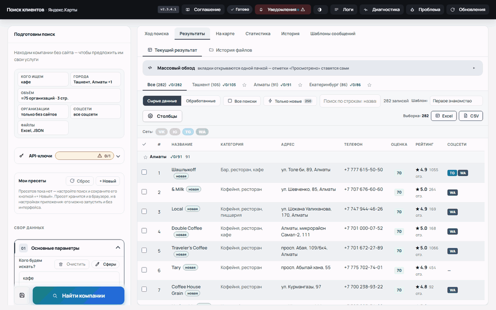
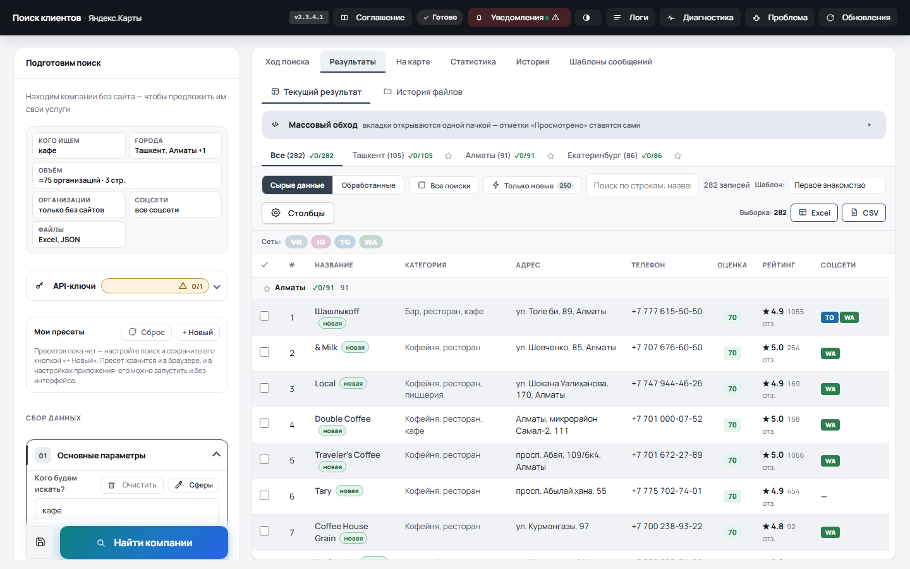
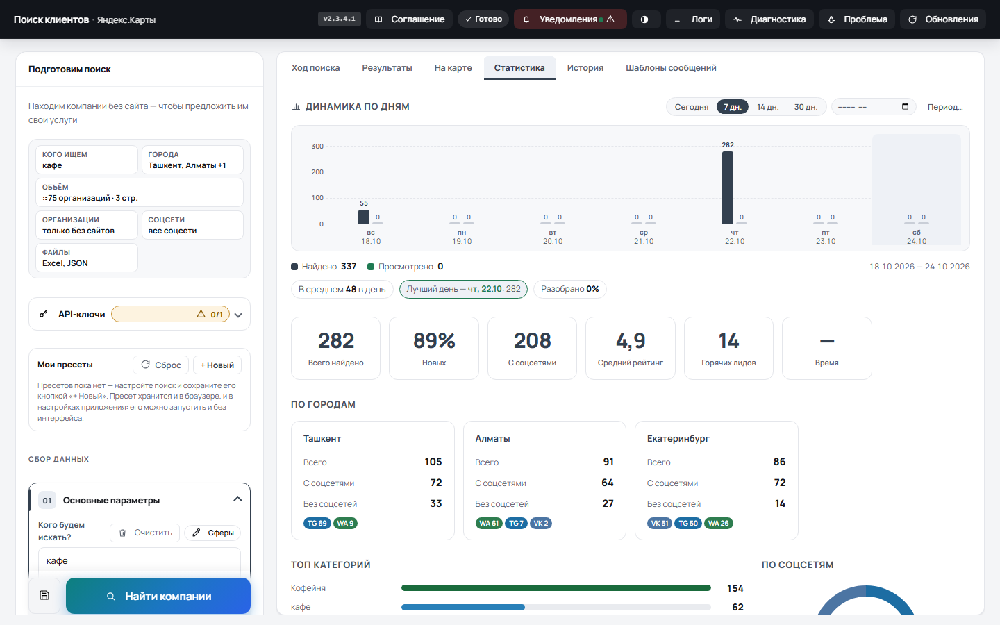
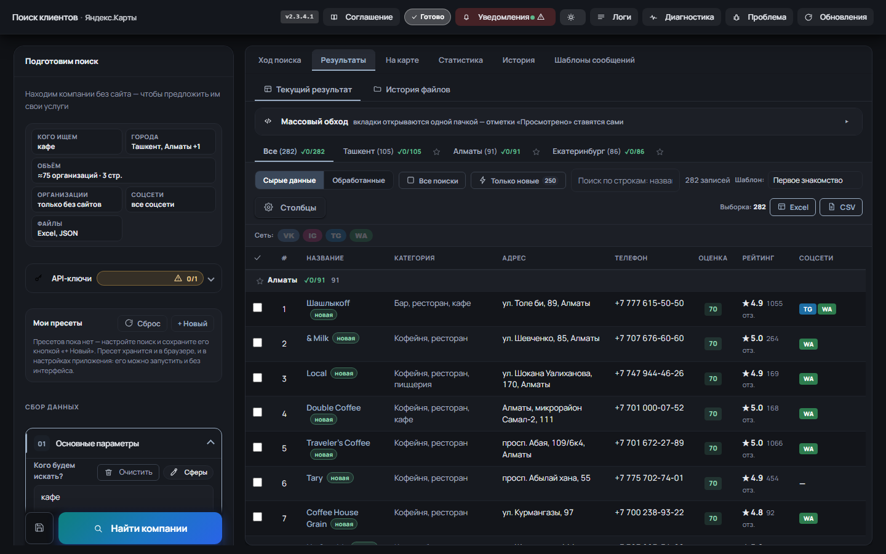
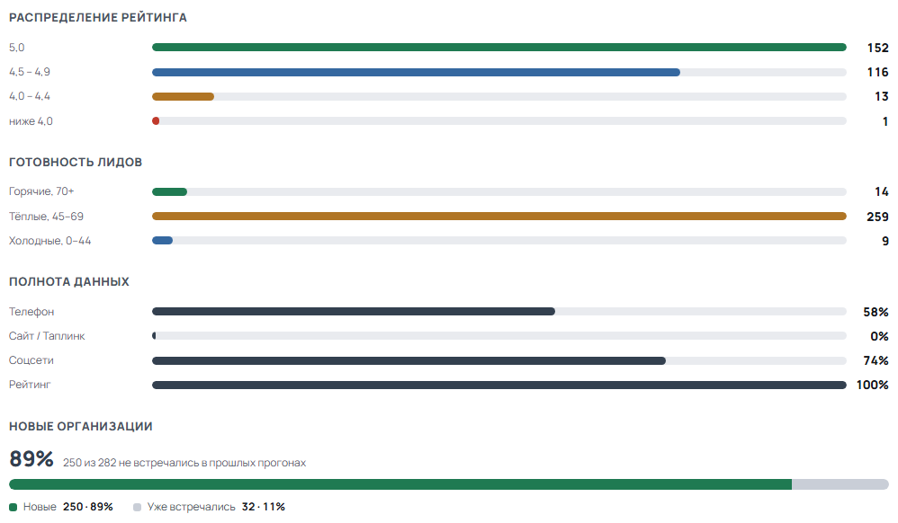

# 🔍 Yandex Business Parser

[](https://github.com/ScarFace11/Yandex-Buisnes-Parser/actions/workflows/ci.yml)
[](https://github.com/ScarFace11/Yandex-Buisnes-Parser/releases/latest)
[](https://www.python.org/)
[](tests)
[](LICENSE)

**Приложение для сбора и скоринга базы организаций с Яндекс.Карт.** Находит
компании без сайта, собирает контакты и соцсети, считает оценку лида 0–100 и
выгружает в Excel. Работает локально, собирается в `.exe` для Windows и `.app`
для macOS, платных API не требует.



<sub>Реальный прогон: 282 организации из Ташкента, Алматы и Екатеринбурга по
трём запросам; 250 из них не встречались в прошлых поисках. Скриншоты сняты с
работающего приложения, а не нарисованы в макете.</sub>

| | |
|---|---|
| **Стек** | Python 3.12, Flask, чистый JS без сборщика, Chrome DevTools Protocol, openpyxl, PyInstaller |
| **Проверок** | ≈1800 pytest, 21 файл тестов интерфейса на node, браузерные проверки доступности |
| **CI** | Ubuntu, Windows и macOS на каждый PR; отдельные workflow сборки и проверки ассетов релиза |
| **Данные** | только локально: файлы в `output/`, API слушает `127.0.0.1` |

Страницы открывает **настоящий браузер** (Chrome по Chrome DevTools Protocol) —
как это делает человек. Ключей платных API приложение не использует: и поиск,
и карточки читаются со страниц Яндекс.Карт, поэтому вводить в него ничего не
нужно, кроме необязательного токена ВК для фильтра активности.

Собирает в multi-city режиме, живая статистика и таблица результатов,
graceful-пауза/стоп, чекпоинт-возобновление. Работает как локально
(`python app.py`), так и из готовых сборок.

Актуальная версия — **2.3.4.2**. Сборки ниже 2.3.4 не запускаются: с 2.3.4
действует обязательное пользовательское соглашение (см. раздел «Минимальная
версия» ниже).

## 🖼 Экраны



Таблица текущего прогона: оценка лида, рейтинг и число отзывов, соцсети,
отметки «Просмотрено». «Только новые» оставляет 250 записей из 282 — тех, кого
не было в прошлых выгрузках.



Статистика считает прогон целиком: динамику по дням, разрез по городам, топ
категорий и соцсетей, а в карточках — средний рейтинг, горячие лиды и долю
новых организаций.

<details>
<summary>Тёмная тема и разборы статистики</summary>





</details>

## 🏗 Как устроено

Одностраничный Flask-сервер управляет настоящим Chromium-браузером по CDP, а
результаты складывает в файлы. Прогон живёт в отдельном процессе и общается с
интерфейсом через очередь и SSE, поэтому тяжёлый сбор не блокирует страницу, а
пауза оставляет после себя чекпоинт и корректно закрытые выгрузки. Сбор идёт в
два этапа: `raw/` — всё найденное, `processed/` — после фильтров, так что
«Применить фильтры заново» не требует повторного парсинга.

Подробнее — [ARCHITECTURE.md](ARCHITECTURE.md): схема компонентов, поток
прогона и разбор решений с компромиссами.

---

## ✨ Ключевые возможности

- **Сбор из Яндекс.Карт**: организации берутся из данных самой страницы выдачи
  (один запрос вместо прокрутки, 4–8 секунд на город), карточки открывает
  установленный Chrome. Если Яндекс поменяет страницу, включается прежний
  разбор вёрстки — поиск не остаётся без данных.
- **Multi-city**: несколько городов и поисковых запросов за один запуск,
  история поисков по городам, graceful-пауза («завершаем город»), продолжение
  с чекпоинта и быстрый стоп.
- **Предфильтр на сборе**: чёрный список («🚫 Исключить по словам»), «только
  без сайтов» и соцсети отсекают организацию ещё до загрузки карточки — она не
  попадает ни в живую таблицу, ни в `raw/`, а в логе видно, сколько отброшено.
  Остальные фильтры (объединение филиалов, «🎯 Тип компании», оценка лида)
  пересчитываются из уже собранного кнопкой «🔄 Применить фильтры заново».
- **Оценка лида 0–100** для каждой организации: нет своего сайта +30,
  рейтинг ≥ 4.5 +15, отзывов ≥ 50 +15, телефон +10, дорогая категория +10,
  есть соцсети +10, карточка появилась недавно +10. Семь сигналов дают ровно
  100; активность ВК — бонус +10/+5, который добирает баллы до 100, но шкалу
  не растягивает. Без ключа ВК критерий не оценивается вовсе, а не считается
  «неактивным». Пресеты, сортировка «сначала горячие», разбор оценки по клику
  на балл (мини-окно: какие критерии сработали, какие нет, сумма из максимума).
- **Кэш карточек**: страница, которую браузер отдал целиком, сутки лежит в
  `output/.cache/` — повторный прогон по тем же городам не ждёт браузер на
  каждой организации (`YP_PAGE_CACHE=0` выключает, `YP_PAGE_CACHE_TTL` и
  `YP_PAGE_CACHE_MB` задают срок и объём).
- **Таблица результатов**: порядок столбцов настраивается перетаскиванием
  («Столбцы» → за ⠿ или стрелками) и запоминается; «Рейтинг» по умолчанию
  рядом с «Оценкой», видимость и порядок независимы. Выгрузка выборки
  («Выборка: Excel / CSV») содержит сайт, рейтинг и число отзывов, а рядом
  с кнопками видно, сколько строк под текущими фильтрами. «Только новые»
  прячет организации, которые уже встречались в прошлых поисках, число новых
  видно на самой кнопке, а у новых строк у названия стоит метка «новая». В режиме
  «Все» строки сгруппированы по городам (перед организациями идёт полоса с
  названием города), а город со звёздочкой закрепляется сверху — и во
  вкладках городов, и в группах.
- **Массовый обход соцсетей**: открыть N профилей разом (вкладки не блокируются
  браузером), отметки «Просмотрено» с автосохранением в xlsx. Галочка
  «Только под фильтром» обходит ровно те строки, что видны в таблице.
- **Статистика с графиками** во вкладке «Статистика»: динамика по дням (сколько
  найдено и разобрано за каждый день, «Сегодня» по часам, календарный месяц и
  произвольный диапазон), кольцевая диаграмма соцсетей и топ категорий — и три
  новых разбора: «Распределение рейтинга» (5,0 / 4,5–4,9 / 4,0–4,4 / ниже и
  совсем без оценки), «Готовность лидов» (горячие 70+, тёплые 45–69,
  холодные) и «Полнота данных» (какая доля записей заполнена по телефону,
  сайту, соцсетям и рейтингу). В итоговых карточках сразу видны средний
  рейтинг, число горячих лидов и доля новых организаций в текущем прогоне,
  а отдельная полоса делит записи на новые и уже встречавшиеся.
- **Тема «как в системе»**: кнопка темы в шапке переключает светлую, тёмную и
  системную — последняя (по умолчанию) следует за темой операционной системы
  и меняется вместе с ней.
- **Сообщить о проблеме одной кнопкой**: в шапке есть «Проблема» — окно
  собирает контекст (версия и система, браузер, последний прогон, хвост лога,
  настройки), подбирает метки GitHub и создаёт issue. Токен вводить не нужно:
  приложение входит в GitHub по короткому коду — пользователь подтверждает
  доступ на github.com/login/device, и всё.
- **Выбор браузера для сбора**: если Chrome, Edge и Яндекс Браузер стоят
  рядом, «первый найденный» — не обязательно тот, которым пользуются.
  В «Основных параметрах» есть список найденных Chromium-браузеров, выбор
  хранится в `settings.json` и применяется со следующего запуска; удалённый
  или перенесённый браузер не ломает поиск — приложение откатывается на
  автоматический выбор.
- **Сферы бизнеса**: выпадающий список у поля «Кого будем искать?» — готовые
  наборы слов по нишам («Стоматология» → «стоматология», «зубной врач»;
  «Салоны красоты» → «салон красоты», «маникюр»). Под каждой сферой видно,
  когда её уже парсили и по каким городам: список собран из истории поиска,
  так что очистка истории очищает и эти подписи.
- **Данные под защитой**: отметки «Просмотрено» ежедневно страхуются в
  `output/_backup/` (7 дней); «Экспорт/Импорт данных» во вкладке «Форматы
  вывода» переносит отметки и настройки между машинами одним zip-архивом;
  срок хранения выгрузок настраивается (7/14/30 дней или своё число).
- **Обновление из приложения**: новая версия скачивается и ставится сама
  (Windows), на macOS — баннер со ссылкой на страницу релизов.
- **Автоматизация без окна**: REST API на 127.0.0.1 (поиск, пачка заданий,
  событие по завершении, OpenAPI) и консольный режим — сбор по сохранённому
  пресету (`--run`) и самопроверка (`--check`) без запуска интерфейса.

## 🚀 Быстрый старт

```bash
git clone https://github.com/ScarFace11/Yandex-Buisnes-Parser.git
cd Yandex-Buisnes-Parser && pip install -r requirements.txt
python app.py
```

Откройте **http://localhost:5000** и нажмите «Найти компании». Ключи вводить не
нужно; чтобы приложение работало, на машине должен быть установлен **Chrome**
(или Chromium) — страницы открываются в нём.

## 📥 Установка

### Windows (.exe)

Скачайте `YandexBusinessParser-windows-x64.zip` со страницы
[Releases](https://github.com/ScarFace11/Yandex-Buisnes-Parser/releases/latest),
распакуйте и запустите `YandexBusinessParser.exe`. При первом запуске
SmartScreen может предупредить о неподписанном файле — «Подробнее → Выполнить
в любом случае». Авто-обновление встроено: новая версия скачивается и
устанавливается из самого приложения.

### macOS (.app)

Скачайте `YandexBusinessParser-macos-*.dmg` из
[Releases](https://github.com/ScarFace11/Yandex-Buisnes-Parser/releases/latest)
(arm64 — Apple Silicon, x64 — Intel), перетащите `.app` в `/Applications` и
запустите двойным кликом. Приложение само откроет браузер; данные живут в
`~/Library/Application Support/YandexBusinessParser`.

> Без подписи Developer ID macOS спросит подтверждение при первом запуске:
> правый клик → «Открыть» → «Открыть», либо
> `xattr -dr com.apple.quarantine /Applications/YandexBusinessParser.app`.
> Сборки с подписью и нотаризацией запускаются без предупреждений —
> см. [«Как настроить подпись macOS»](docs/build.md#как-настроить-подпись-macos).

> **Версии ниже 2.3.4 больше не работают.** С 2.3.4 действует обязательное
> пользовательское соглашение, поэтому всё, что старше, блокируется и требует
> обновления — подробности в разделе
> [«Минимальная версия»](#-минимальная-версия-приложения). Проверьте, что
> скачали именно актуальный архив.

## 🤖 Что нужно на машине

| Что | Зачем | Обязательно |
|---|---|---|
| Chrome (или Chromium) | страницы выдачи и карточек открывает браузер — единственный движок сбора | да |
| `VK_TOKEN` | фильтр «Проверять активность ВКонтакте» (право читать сообщества: `wall`, `groups`) | нет |
| `YP_PORT` | свой порт, если 5000 занят | нет |
| `YP_PAGE_CACHE=0` | отключить кэш страниц карточек | нет |

Ключи Яндекса и 2ГИС приложению не нужны: платные API не используются вовсе
(их бесплатные тарифы запрещают сохранять данные), а соцсети и телефоны
разбираются со страниц организаций. Токен ВК вводится в боковой панели
(«Настройки») и сохраняется в `.env` одной кнопкой.


## 📖 Основные сценарии

1. **Собрать базу по нескольким городам.** Вкладка «Глубина поиска»: города и
   запросы (лимиты — в `config.py`: `MAX_PAGES`, `MAX_CANDIDATES_PER_CITY`).
   Результат — файлы этапа 1 в `raw/` и обработанные по фильтрам.
2. **Отобрать горячих лидов.** Аккордеон «Фильтрация результата»: обязательные
   соцсети, «Оценка лида ≥ 70», сортировка «сначала горячие». В таблице —
   колонка «Оценка» с разбором в подсказке, отметки «Просмотрено» сохраняются
   в файл автоматически.
3. **Обойти профили перед сообщением.** В таблице выберите сеть и
   «🚀 Открыть 5 профилей» — откроется ровно N вкладок с непросмотренными
   профилями. Текст можно собрать из шаблонов (вкладка «📝 Шаблоны», включая
   составные и случайные переменные) и скопировать в буфер.
4. **Перефильтровать без повторного сбора.** Меняете фильтры →
   «🔄 Применить фильтры заново» → новые файлы этапа 2 из уже собранного.
   Исключение — фильтры, которые сбор применяет сам (чёрный список, «только
   без сайтов», соцсети): расширить срез можно только новым сбором.

## 🔌 REST API для автоматизации

Приложение слушает **только 127.0.0.1** — наружу ничего не выходит и ключ API
не нужен. На Windows это `http://127.0.0.1:5000` (на macOS — 5050, порт
переопределяется переменной `YP_PORT`).

```bash
# 1. Запустить поиск — вернётся run_id, поиск идёт в фоне
curl -X POST http://127.0.0.1:5000/api/v1/search \
     -H "Content-Type: application/json" \
     -d '{"queries": ["кафе"], "cities": ["Москва"]}'

# 2. Дождаться конца и забрать организации одним списком
curl "http://127.0.0.1:5000/api/v1/results?run_id=…&wait=120"
```

- `POST /api/v1/search` — запуск прогона; `GET /api/v1/results` — сами
  организации в JSON (большие ответы страницами: `?limit=50&offset=0`).
- `POST /api/v1/batch` — пачка заданий одним запросом (записи как строки
  таблицы), прогресс и результаты пачки — `GET /api/v1/batch/<id>`.
- `callback_url` в запросе — по завершении прогона приложение само отправит
  туда POST (Webhook-нода n8n) вместо опроса статуса.
- `GET /api/v1/openapi.json` — спецификация всех эндпоинтов (Postman,
  генераторы клиентов).

Готовые воркфлоу для n8n лежат в репозитории:
[yandex-parser-search.json](integrations/n8n/yandex-parser-search.json) и
[yandex-parser-batch.json](integrations/n8n/yandex-parser-batch.json).

## ⌨️ Работа из консоли

```bash
YandexBusinessParser.exe --run --preset «Уфа стоматология»   # сбор без интерфейса
YandexBusinessParser.exe --check                            # самопроверка, окно не нужно
```

Из исходников — то же самое: `python app.py --run …` и `python app.py --check`.
`--run` берёт сохранённый пресет (тот же движок и те же настройки, что у кнопки
«Найти компании»), логи идут в консоль, выгрузки — в обычную папку результатов;
`--dry-run` показывает план, ничего не запуская, `--list-presets` — список
пресетов. `--check` повторяет проверки окна «Диагностика» без сервера и браузера
(код возврата 1 — есть ошибки, 0 — только предупреждения), поэтому команды
можно гонять в фоне, по SSH и в CI; с `--deep` добавляется живая проба
браузера и выдачи.

## 🔒 Пользовательское соглашение и минимальная версия

### Соглашение

При первом входе интерфейс заблокирован, пока не принято пользовательское
соглашение (редакция 1.1). В тексте —
правовые ориентиры: 152-ФЗ, ст. 18 ФЗ «О рекламе», правила площадок,
ответственность пользователя.

### Минимальная версия: «ниже этой версии — не работаем»

Порог публикуется в [static/version.json](static/version.json) полем
`min_version` и означает: сборки старше этой версии не должны работать вообще.
Сейчас там **2.3.4** — версия, в которой появилось обязательное соглашение.

Как это выглядит для пользователя старой сборки:

- при открытии интерфейса показывается окно «Нужно обновить приложение» вместо
  рабочих панелей (окно лежит поверх интерфейса и закрыть его нечем);
- поиск не запускается и через API: `POST /run` отвечает `409` с текстом
  «обновитесь до v2.3.4» — блокировка не «на словах» (см.
  [routes/parser.py](routes/parser.py));
- кнопка «Открыть страницу загрузки» ведёт на страницу релизов, и приложение
  больше не предлагает установить версию, которая тоже ниже порога.

---

## 📄 Документация

- [ARCHITECTURE.md](ARCHITECTURE.md) — как устроено приложение и почему именно
  так: компоненты, поток прогона, компромиссы.
- [CHANGELOG.md](CHANGELOG.md) — что изменилось для пользователя, по версиям.
- [docs/build.md](docs/build.md) — сборка и запуск из исходников: локальные
  сборки `.exe`/`.app`, подпись macOS, автоматизация в GitHub, тесты, порог
  минимальной версии.
- [Issues](https://github.com/ScarFace11/Yandex-Buisnes-Parser/issues) — баги
  и предложения.

## 📄 Лицензия

Проект распространяется по лицензии MIT — см. [LICENSE](LICENSE). Её
выбрал автор; изменяя код, сохраняйте уведомление о копирайте.
